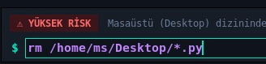
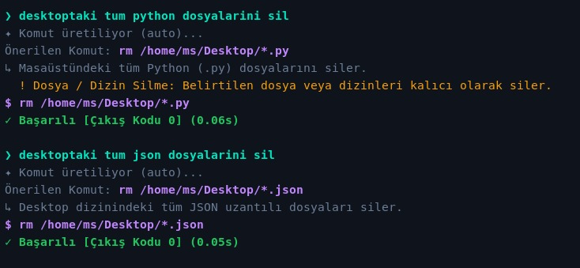
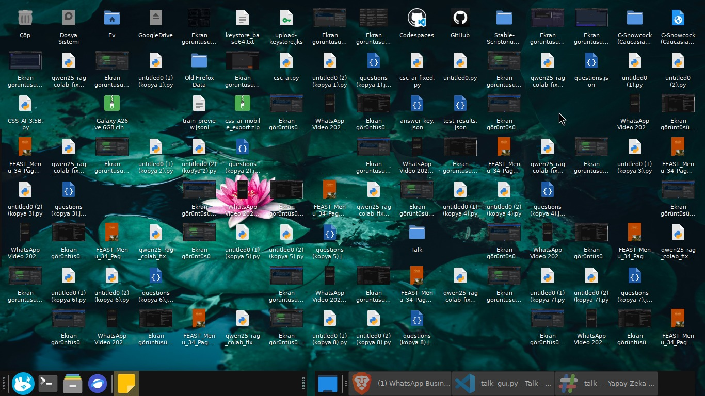
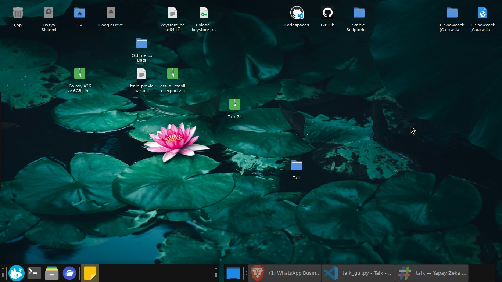

# TALK — Terminal Assistant via Language Knowledge

TALK, doğal dildeki istekleri tek satırlık, güvenli ve kullanıma hazır Bash komutlarına çeviren bir terminal asistanıdır. Projenin temel hedefi şudur:

* Kullanıcıdan doğal dil girdisi alır,
* Uygun bir LLM sağlayıcısından (Gemini / Groq) komut üretir,
* Komutu gelişmiş **güvenlik analiziyle** tarar ve risk seviyesini belirler,
* Gerekli durumlarda kullanıcıdan onay ister ve risk uyarısı verir,
* Canlı çıktıyı izleyerek komutu çalıştırır,
* Tüm işlem geçmişini SQLite üzerinden saklar.

Bu yaklaşım sayesinde kullanıcılar karmaşık terminal komutlarını ezberlemek veya manuel kopyalayıp yapıştırmak yerine, ne yapmak istediklerini doğal dille ifade ederler. Sistem ise güvenlik ve doğrulama katmanıyla terminali korur.

---

## 1) Öne Çıkan Özellikler ve Görsel Deneyim

TALK sadece komut üretmekle kalmaz; riskli komutları tespit eder, masaüstü veya sistem üzerindeki toplu işlemleri güvenle yürütmenizi sağlar.

### 🛡️ Real-Time Güvenlik ve Risk Uyarısı

Model bir komut ürettiğinde veya kullanıcı komut üzerinde değişiklik yaptığında `security.py` motoru anlık olarak devreye girer. Yüksek riskli (örneğin toplu dosya silme) komutlarda hem CLI hem de GUI üzerinde belirgin risk etiketleri (`YÜKSEK RİSK`) gösterilir.


*Şekil 1: Masaüstündeki Python dosyalarını silmeye çalışırken arayüzde tetiklenen YÜKSEK RİSK uyarısı.*


*Şekil 2: CLI üzerinde doğal dilden komuta dönüştürme, güvenlik uyarısı ve canlı çalıştırma adımları.*

---

### 🧹 Gerçek Dünya Kullanımı: Masaüstü Temizliği (Before & After)

TALK'ın doğal dil algılama yeteneği sayesinde karmaşık veya riskli dosya işlemleri saniyeler içinde gerçekleştirilebilir:

1. **Girdi:** `desktoptaki tum python dosyalarini sil`  
   → **Önerilen Komut:** `rm /home/ms/Desktop/*.py` *(Risk Uyarısı: Kalıcı silme)*
2. **Girdi:** `desktoptaki tum json dosyalarini sil`  
   → **Önerilen Komut:** `rm /home/ms/Desktop/*.json`

#### 🔴 Öncesi (Before)

Masaüstü yüzlerce geçici `.py`, `.json` ve test dosyasıyla tamamen karmaşık durumdadır:



#### 🟢 Sonrası (After)

TALK komutları onaylanıp çalıştırıldıktan sonra, tüm hedef dosyalar güvenle temizlenir ve geriye yalnızca ana dizinler ile proje klasörleri kalır:



---

## 2) Proje Mimari Akışı

TALK, arayüz ve iş mantığını net şekilde ayırır. CLI veya GUI fark etmeksizin tüm istekler aynı güvenlik ve doğrulama hatlarından geçer:

```text
Kullanıcı İstemi ("desktoptaki tüm python dosyalarını sil")
    ↓
CLI (talk.py) / GUI (talk_gui.py)
    ↓
TalkPipeline.generate()
    ↓
CommandApiPipeline (Gemini / Groq Sağlayıcıları)
    ↓
parse_response() & validate_generated_command()
    ↓
security.analyze_command() → [ CRITICAL / DANGEROUS / CAUTION / SAFE ]
    ↓
Kullanıcı Onay / Risk Gösterim Kapısı
    ↓
executor.execute_stream() (Canlı Çıktı İzleme)
    ↓
SQLite History Manager (Geçmişe Kayıt)
```

---

## 3) Klasör Yapısı

```text
Talk/
├── README.md
├── pyproject.toml
├── talk.py                 # CLI arayüzü ve REPL döngüsü
├── talk_gui.py             # Tkinter tabanlı masaüstü arayüzü
├── talk_core/              # Ana iş mantığı ve çekirdek modüller
│   ├── __init__.py
│   ├── config.py           # Yapılandırma ve API anahtarı yönetimi
│   ├── confirm.py          # Kullanıcı onay mekanizması
│   ├── executor.py         # Subprocess canlı komut çalıştırıcı
│   ├── history.py          # SQLite geçmiş yönetimi
│   ├── llm.py              # LLM yanıt ayrıştırma ve doğrulama
│   ├── models.py           # Veri modelleri
│   ├── pipeline.py         # Ana iş akışı koordinatörü (TalkPipeline)
│   ├── security.py         # Shell komut güvenlik analiz motoru
│   └── api/                # Çoklu LLM sağlayıcı katmanı
│       ├── __init__.py
│       ├── credentials.py
│       ├── http.py
│       ├── pipeline.py
│       ├── prompts.py
│       ├── providers.py    # Gemini & Groq entegrasyonu
│       ├── registry.py     # Model yönlendirme ve fallback
│       └── types.py
├── Photos/                 # Ekran görüntüleri (1.png, 2.png, 3.png, 4.png)
├── assets/                 # Logo ve uygulama ikonları
├── tests/                  # Güvenlik, onay ve geçmiş birim testleri
└── talk.egg-info/
```

---

## 4) Ana Modüller ve Sorumlulukları

### 4.1 `talk.py` (CLI)
- Etkileşimli terminal (REPL) döngüsü.
- `run_command_live()` ile komut çıktısını ekrana anlık yazar.
- `confirm_command()` ile risk seviyesini gösterir, onay ister veya komut düzenleme seçeneği sunar.

### 4.2 `talk_gui.py` (Masaüstü Arayüzü)
- Tkinter tabanlı modern arayüz.
- Arama destekli geçmiş paneli, anlık risk seviyesi rozetleri (`YÜKSEK RİSK`, `DİKKAT`, `GÜVENLİ`).
- Canlı terminal çıktı ekranı ve API anahtarı ayarlar paneli.

### 4.3 `talk_core/security.py` (Güvenlik Motoru)
Komut string'ini analiz ederek 4 seviyeli risk derecelendirmesi yapar:
- **`CRITICAL`**: `rm -rf /`, `mkfs`, `dd` veya `curl | bash` gibi yıkıcı işlemler.
- **`DANGEROUS`**: `rm /path/*.ext`, `sudo`, `shutdown`, `eval` gibi veri kaybı riski taşıyan durumlar.
- **`CAUTION`**: `chmod`, `mv`, paket yöneticisi (`apt`, `pip`) kullanımı veya servis yönetimi.
- **`SAFE`**: `ls`, `cat`, `df -h`, `pwd` gibi okuma ve durum kontrolü komutları.

### 4.4 `talk_core/llm.py` & `api/` (Model ve Yanıt Katmanı)
- LLM'den gelen markdown veya bozuk yapıları temizler, sadece geçerli tek satırlık shell komutu üretir.
- Otomatik **fallback** mekanizması sayesinde seçili model yanıt vermezse yedek modele geçer.

### 4.5 `talk_core/history.py` (Geçmiş Saklama)
- Tüm çalıştırma sonuçlarını (`prompt`, `command`, `risk_level`, `return_code`, `timestamp`) `history.db` SQLite veritabanında saklar.

---

## 5) Yapılandırma ve Anahtar Yönetimi

Konfigürasyon dosyası varsayılan olarak `~/.talk/config.json` yolunda saklanır.

Örnek `config.json`:

```json
{
  "model": "auto",
  "safe_mode": true,
  "api_timeout": 30,
  "exec_timeout": 60,
  "max_output_chars": 200000,
  "api_credentials": [
    {"provider": "gemini", "key": "AIza..."},
    {"provider": "groq", "key": "gsk_..."}
  ],
  "os_preset": "linux"
}
```

Ortam değişkenleri (Environment Variables) üzerinden de tanımlama yapılabilir:

```bash
export GEMINI_API_KEY='AIza...'
export GROQ_API_KEY='gsk_...'
export TALK_MODEL='auto'
```

---

## 6) Kurulum ve Çalıştırma

### Gereksinimler
- Python 3.10+
- Linux / macOS / Windows (Tkinter desteği ile)

```bash
# Depoyu klonlayın ve dizine geçin
cd Talk

# Sanal ortam oluşturun ve aktif edin
python3 -m venv .venv
source .venv/bin/activate

# Paketi geliştirici modunda kurun
pip install -e .

# Linux GUI desteği için Tkinter kurulumu (gerekirse)
sudo apt install python3-tk
```

### Kullanım Komutları

```bash
# Etkileşimli CLI başlat
talk

# Doğrudan tek komut çalıştır
talk "şu anki klasörde en büyük 10 dosyayı göster"

# GUI arayüzünü başlat
talk-gui

# API bağlantılarını test et
talk --test

# Komut geçmişini listele
talk --history
```

---

## 7) Testler

Birim testlerini çalıştırmak için:

```bash
python3 -m unittest discover -s tests -v
```

Mevcut testler şunları doğrular:
- **`test_security.py`**: Tehlikeli komut kalıplarının doğru tespit edilmesi.
- **`test_confirm.py`**: Onay kapısının güvenli mod kurallarına uyması.
- **`test_history.py`**: SQLite kayıt ve arama işlevselliği.

---

## 8) Lisans

Bu proje [MIT Lisansı](LICENSE) altında sunulmuştur.
